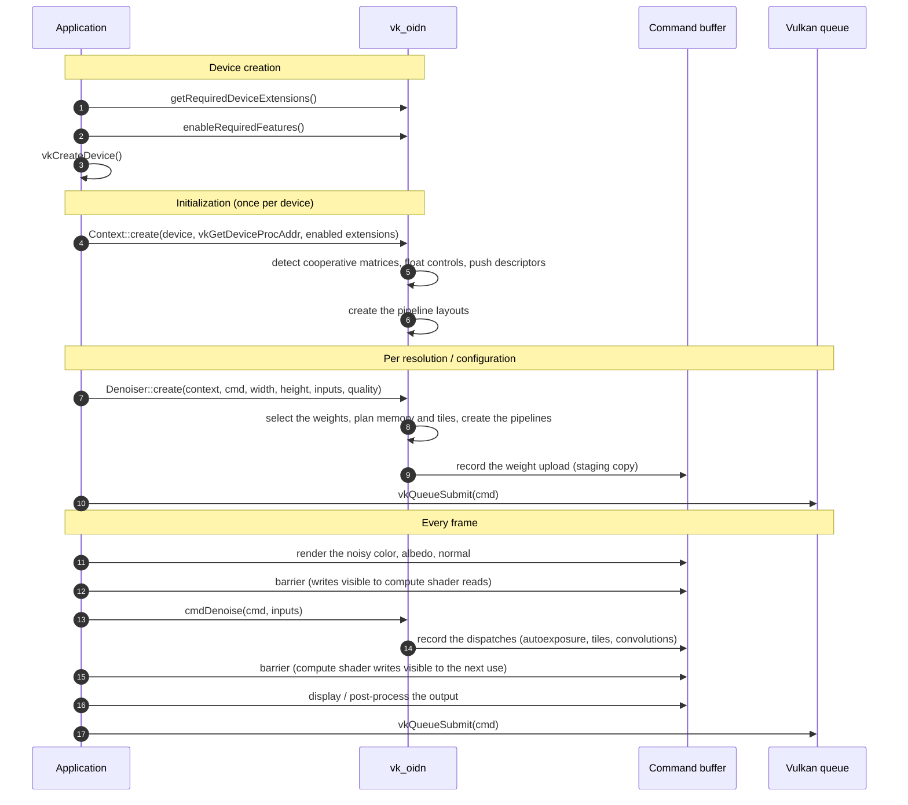
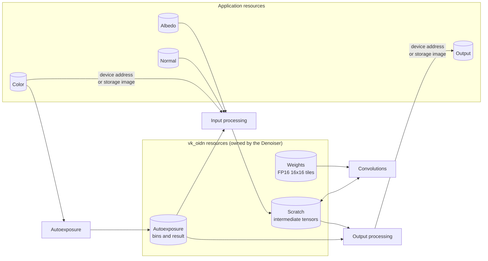
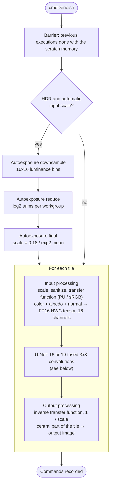
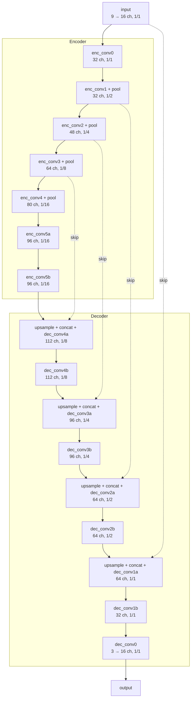
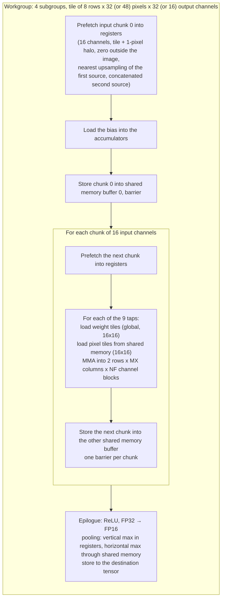
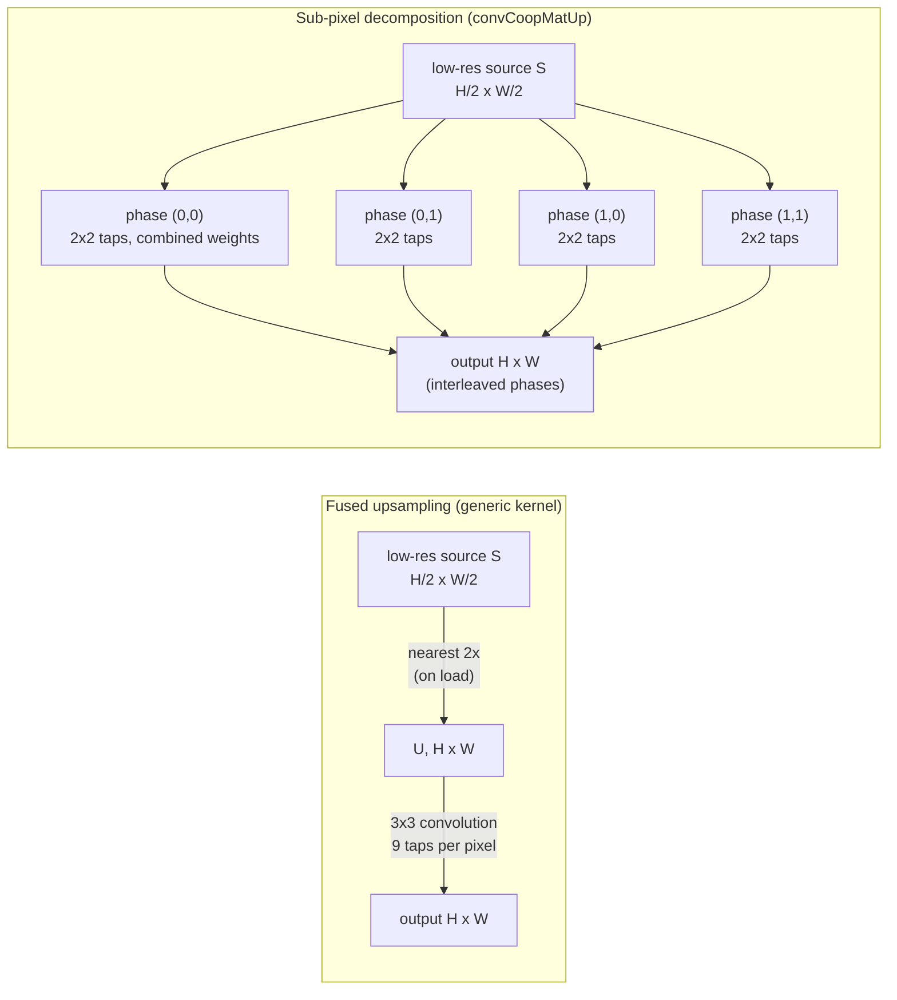
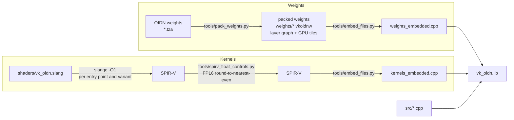

# vk_oidn architecture

This document explains how vk_oidn works: how an application integrates it, what happens on the
GPU when an image is denoised, and how the network and its kernels are organized. Measured
results are in [validation_and_performance.md](validation_and_performance.md).

vk_oidn runs the `RT` filter of [Intel® Open Image Denoise](https://github.com/RenderKit/oidn)
(OIDN): a U-Net convolutional network trained to remove Monte Carlo noise from rendered images,
optionally guided by albedo and normal images. The network weights are OIDN's; the GPU kernels
and the runtime are vk_oidn's (derived from the Vulkan backend of the
[OIDN fork](https://github.com/mklefrancois/oidn-vulkan)).

## 1. Integration in a Vulkan application

The library never creates its own device, queue or command buffers. Like DLSS, it records work
into command buffers owned by the application, which submits them whenever and wherever it wants.

All memory is accessed by device address (`VK_KHR_buffer_device_address`), passed in push
constants, so the kernels need no descriptor sets. Image views, when used, are bound with push
descriptors (`VK_KHR_push_descriptor`) right before the three kernels that touch them.

## 2. The denoising pipeline (one `cmdDenoise` call)

Large images are split into overlapping tiles (by default at most 2160x2160 pixels each, like
OIDN; `maxMemoryMB` lowers this). Each tile runs the whole network, and only the central part of
each tile, without the overlap, is written to the output. Every dispatch is followed by a
compute-to-compute memory barrier.

The **transfer function** maps the input to the range the network was trained on: the
perceptual-uniform (PU) curve for HDR, sRGB for linear LDR, nothing for sRGB-encoded LDR. The
output processing applies the inverse.

## 3. The U-Net

The base network (16 layers) for the `hdr + albedo + normal` model is below. Each box is a single
kernel dispatch: pooling, upsampling and concatenation are fused into the convolutions, so no
intermediate pooled/upsampled/concatenated tensors are ever written. The numbers are the output
channels; resolutions are relative to the tile.

All convolutions are 3x3 with bias and ReLU. The large network (`rt_hdr_calb_cnrm_large`, used
in high quality with clean auxiliary images) has two convolutions per encoder level and wider
layers (64 to 256 channels). The graph is not hard-coded in the runtime: each packed weight file
contains its layer table (sources, fused operations, channel counts), and the runtime executes it
in order.

The intermediate tensors (FP16, channels-last, padded to multiples of 16 channels) are placed in
one scratch buffer. The planner assigns offsets from the tensor lifetimes, largest first, so
tensors that are not alive at the same time share memory (1920x1088 tile: 384 MB for the base
network).

## 4. The convolution kernel

The 3x3 convolutions are computed as implicit GEMMs on tensor cores, with
`VK_KHR_cooperative_matrix` 16x16x16 FP16 matrices: M = output pixels, N = output channels,
K = 3x3 taps x input channels. Accumulation is FP32 in high quality and FP16 in the balanced and
fast modes, like OIDN's CUDA backend.

Design points:

- **Double buffering**: the global loads of the next input chunk overlap the matrix
  multiplications of the current one, with a single barrier per chunk.
- **Pooling fusion**: each subgroup owns two consecutive output rows, which are exactly the rows
  of the 2x2 pooling windows, so pooling needs no exchange between subgroups.
- **Upsampling and concatenation fusion**: the concatenation is done while loading the input
  tile into shared memory (the concatenated tensor never exists in memory). For the upsampled
  source, a dedicated kernel (`convCoopMatUp`) uses a **sub-pixel decomposition**: a 3x3
  convolution of a 2x nearest-upsampled tensor equals four 2x2 convolutions of the
  low-resolution tensor (one per output phase) with combined weights, which needs 56% fewer
  multiply-adds. Each subgroup computes one phase, so each combined weight tile is reused by
  4 matrix fragments (section below).
- **Per-layer tile selection**: 32x8 pixels x 32 channels by default, 48 pixels wide for layers
  with more than 64 input channels (more reuse of the weights), and 16 channels per workgroup for
  layers with an odd number of 16-channel blocks or too few workgroups to fill the GPU.
- **Fallback**: GPUs without cooperative matrices (and non-NVIDIA GPUs by default) use a plain
  FMA kernel with the same tiling of the input.

### Sub-pixel decomposition of the upsampling layers

Along each axis, output position 2m + p reads the upsampled positions 2m + p - 1, 2m + p, 2m + p + 1,
which are the source pixels {m - 1, m, m} for p = 0 and {m, m, m + 1} for p = 1. The weights of
the taps reading the same source pixel are summed (on the host, when the denoiser is created):
p = 0 uses {w0, w1 + w2} at offsets {-1, 0}, p = 1 uses {w0 + w1, w2} at offsets {0, +1}. The
skip connection (second source, full resolution) is convolved normally. Disable with
`VK_OIDN_SUBPIXEL=0`.

## 5. Build pipeline

The Slang file is compiled into 20 kernels: input processing, output processing and the
autoexposure downsampling (each with buffer and storage image I/O), the two autoexposure
reductions, image copy, the fallback convolution, 6 cooperative matrix convolution variants
(3 tile shapes x FP32/FP16 accumulation) and 4 sub-pixel upsampling convolution variants
(2 tile shapes x FP32/FP16 accumulation). Each is compiled with and without FP16 float controls;
the variant without them is used on devices which do not support round-to-nearest-even and
denormal preservation for FP16. The experimental `VK_NV_cooperative_matrix2` convolution
(`shaders/experimental/conv_cm2.comp`) is written in GLSL and compiled with glslang.
